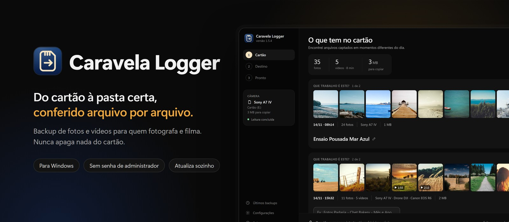
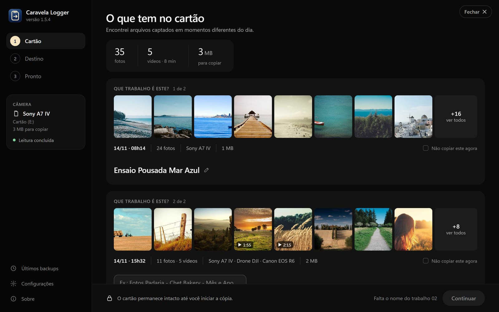
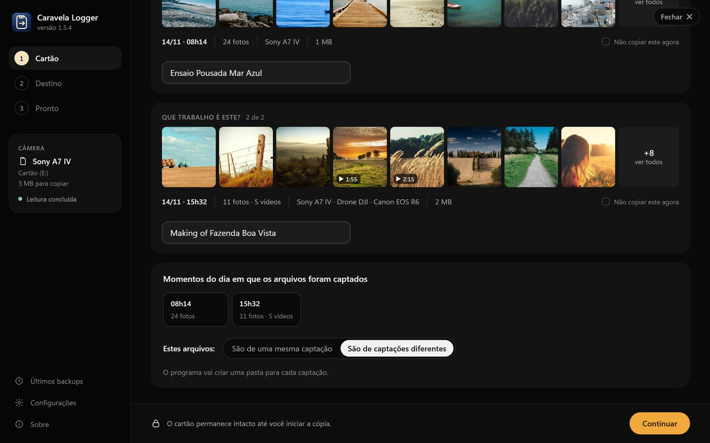
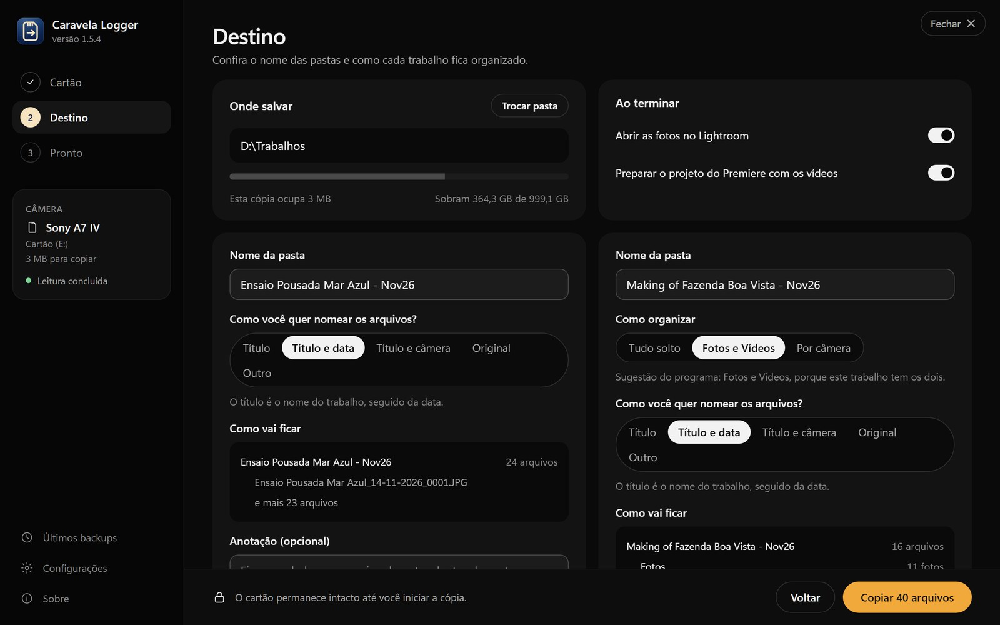
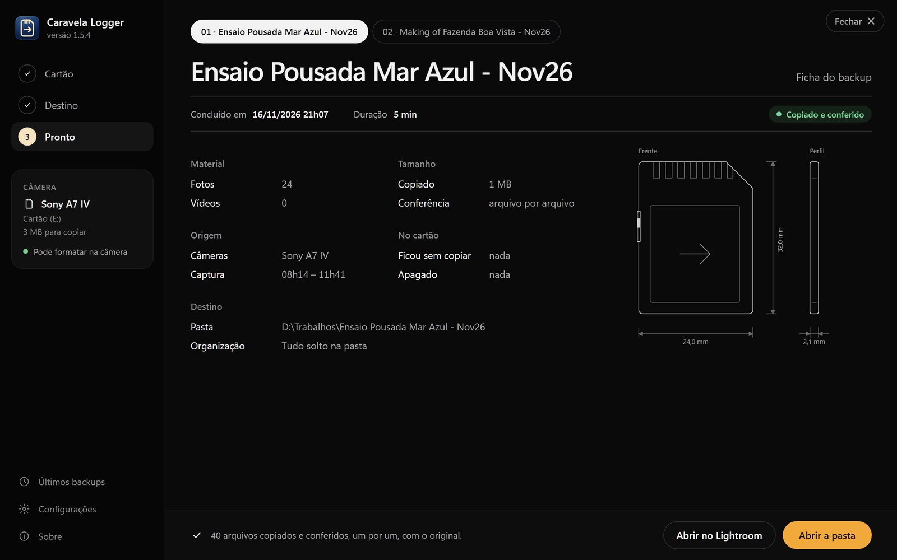
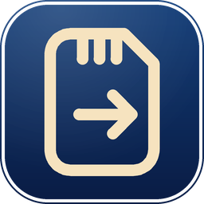

  

  <b>Backup de fotos e vídeos para quem fotografa e filma, no Windows.</b> 
  Conecte o cartão ou a câmera. O Caravela Logger separa o material por trabalho, copia para a pasta certa 
  e confere cada arquivo com o original. Ele nunca apaga nada do cartão.

  
  

  <a href="https://github.com/pedrotofo/caravela-logger/releases/latest"><b>⬇ Baixar</b></a>
  &nbsp;·&nbsp;
  <a href="#como-funciona">Como funciona</a>
  &nbsp;·&nbsp;
  <a href="#equipamentos">Equipamentos</a>
  &nbsp;·&nbsp;
  <a href="#como-instalar">Como instalar</a>
  &nbsp;·&nbsp;
  <a href="#privacidade">Privacidade</a>

  Sony · Canon · Panasonic · Fujifilm · Nikon · Leica · OM System · Blackmagic · RED · ARRI · DJI · GoPro · Insta360 · Zoom · Tascam

 

## Como funciona

Três telas, do cartão até a pasta pronta para editar. **Nada é copiado até você clicar em Copiar.**

<table>
  <tr>
    <td width="40%" valign="top">
      <h3>1 · O que tem no cartão</h3>
      
Assim que o cartão entra, aparece um aviso discreto no canto da tela. O programa mostra fotos, vídeos,
      tamanho, câmeras usadas e miniaturas de tudo.

      
O material vem separado por trabalho: três horas ou mais sem gravar viram trabalhos diferentes.
      Se ele errar, um clique junta ou separa de novo. Você só dá o nome de cada um.

    </td>
    <td width="60%"></td>
  </tr>
  <tr>
    <td width="40%" valign="top">
      <h3>Dias e momentos de captação</h3>
      
Quando o cartão tem material de dias ou horários diferentes, ele mostra cada um e pergunta se é
      uma captação só ou várias. Assim cada trabalho ganha a própria pasta.

      
Um trabalho pode ficar no cartão para copiar depois.

    </td>
    <td width="60%"></td>
  </tr>
  <tr>
    <td width="40%" valign="top">
      <h3>2 · Destino</h3>
      
Escolha o nome da pasta e como os arquivos vão se chamar: título, título e data, título e câmera,
      o nome original ou outro que você digitar.

      
Organize tudo solto, com fotos e vídeos separados ou uma pasta por câmera, e veja como a pasta vai
      ficar antes de copiar.

    </td>
    <td width="60%"></td>
  </tr>
  <tr>
    <td width="40%" valign="top">
      <h3>3 · Pronto</h3>
      
Cada arquivo é conferido com o original depois de copiado. Nada é dado como copiado sem conferência.

      
No fim, a ficha do backup mostra o que foi copiado, de qual câmera e para onde, com botões para abrir a
      pasta, o Lightroom e o projeto do Premiere, e para ejetar o cartão.

    </td>
    <td width="60%"></td>
  </tr>
</table>

Simulação com clientes fictícios e fotos de banco de imagens (Unsplash).

## Em toda cópia

| | |
|---|---|
| **Confere tudo** | Cada arquivo é comparado com o original depois de copiado. |
| **Continua de onde parou** | Se a cópia for interrompida, ele retoma sem copiar nada duas vezes. |
| **Segunda cópia** | Faz uma segunda cópia em outro disco, se você quiser. |
| **Pronto para editar** | Abre as fotos no Lightroom e prepara o projeto do Premiere com os vídeos, quando estiverem instalados. |
| **Registro** | Guarda uma ficha de cada backup e um `_backup_log.csv` com tudo o que foi copiado. |
| **Nunca apaga** | O cartão continua intacto. Formatar fica por sua conta, na câmera. |

## Equipamentos

O programa reconhece sozinho o que foi conectado, pelo jeito que cada câmera organiza o cartão.

| Tipo | Marcas |
|---|---|
| **Câmeras** | Sony (Alpha, FX, Venice), Canon (fotográficas e Cinema EOS), Panasonic (Lumix e P2), Fujifilm, Nikon, Leica, OM System |
| **Cinema** | Blackmagic (BRAW), RED (R3D), ARRI, Canon Cinema RAW |
| **Drones e ação** | DJI, GoPro, Insta360 |
| **Áudio** | Zoom, Tascam e outros gravadores, além de gravadores externos de vídeo |

Câmeras com dois cartões: ele lê o cartão com mais material e avisa que o outro também tem arquivos.
SSDs e HDs externos são ignorados, a não ser que sejam o disco de gravação de uma câmera de cinema.

## Como instalar

1. Baixe o arquivo `CaravelaLogger-…-setup.exe` da [versão mais recente](https://github.com/pedrotofo/caravela-logger/releases/latest).
2. Dê dois cliques. Não precisa de senha de administrador.
3. O instalador ainda não tem assinatura digital. Se o Windows mostrar "O Windows protegeu o computador",
   clique em **Mais informações** e depois em **Executar assim mesmo**.

Depois de instalado, o programa fica ao lado do relógio e **se atualiza sozinho** quando sai uma versão nova.

## Privacidade

O programa roda só no seu computador. Não lê agenda nem e-mail e não envia fotos ou dados para nenhum
servidor. A internet só é usada para ver se existe uma versão nova.

 

   
  Criado por Pedro Tofo, Caravela Studio. 
  Este repositório guarda só os instaladores. © 2026 Pedro Tofo / Caravela Studio. Todos os direitos reservados.

